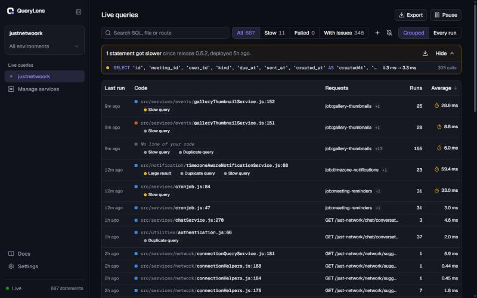
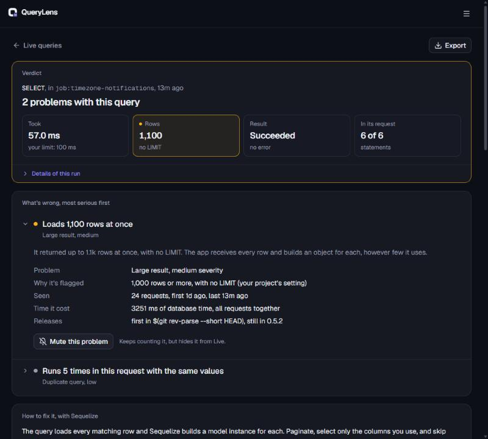
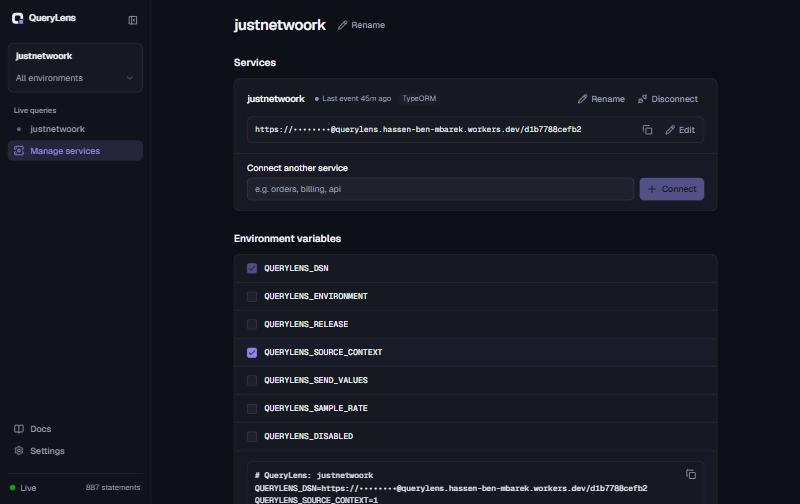

<div align="center">


# QueryLens

**Monitor the SQL your app sends in production. Catch N+1 queries, writes in a loop and
slow statements, and get the fix for your ORM, down to the line of code.**

[](https://github.com/EagleMind/querylens/actions/workflows/ci.yml)
[](https://www.npmjs.com/package/querylens-node)
[](integrations/node)
[](LICENSE)
<br>
[](cloud)


[](crates/core)

</div>

QueryLens is an error tracker for your database traffic. A small SDK in your Node.js backend
watches every query your ORM sends to PostgreSQL, MySQL, SQLite or MongoDB, removes the values, and reports
the requests that look wrong to a backend you deploy in your own Cloudflare account, on the
free plan. The dashboard lists every statement as it arrives, and each one opens a report:
the SQL, the line of your code that ran it, the problem it's part of with the fix written for
your ORM, the rest of its request on a timeline, and its last 24 hours.

```
your app + querylens-node ──── values removed, gzipped ────▶ your Cloudflare Worker ──▶ dashboard
  (pg, postgres.js, mysql2, Neon, …)                          Rust analysis (WebAssembly)
                                                               issues, query history, stats, live feed (Durable Objects)
```

## What it finds

| Finding | What it looks like | Typical fix |
|---|---|---|
| **N+1 queries** | The same SELECT run once per row of the previous result, with different values | Eager loading (`include`, `relations`, `with`, `populate`) or one `IN` query |
| **Duplicate queries** | The identical statement repeated back to back | Run it once and reuse the result |
| **Writes in a loop** | INSERT / UPDATE / DELETE one row at a time | One multi-row INSERT (`bulkCreate`, `createMany`…), one `UPDATE … WHERE id IN (…)` |
| **Large results** | Thousands of rows with no LIMIT | Pagination, selecting only the columns used |
| **Slow statements** | Over 100 ms (adjustable) | An index, with the migration to add it |
| **Failing statements** | Errors, including ones the ORM swallowed | The error, its statement and its caller |
| **Chatty requests** | One request running 50+ statements (adjustable) | Batching, eager loading |

Problems are grouped into issues across requests, environments and releases, each with the
line of your code responsible. An issue you've fixed that comes back is flagged as
**regressed**; one you mute keeps being counted but stays out of your way.

QueryLens also flags **regressions**: statements that got slower, or started failing, since
your latest release. It compares each statement with itself before and after the deploy,
using the statistics the SDK sends for every statement, so it catches the slowdowns no
threshold would.

## The dashboard



- **Live queries**: every statement your services send, as they arrive, with the last 7 days
  a click away. Each row is the line of your code that ran it (`file.js:30`, the SQL in its
  tooltip), grouped by query shape or one row per run, newest first or slowest first. Pick a
  service in the sidebar or see them all; filter by environment, search (SQL, file or route)
  and the built-in views (all, slow, failed, with issues), hide or show muted issues, and save
  your own filters, or describe one ("slow writes on checkout since the last release") and
  check the conditions it fills in. Above the list, the statements that got slower or started
  failing since the latest release.



- **Query report**: ordered for diagnosis. First the verdict and the numbers behind it, then
  what's wrong (most serious first, in plain words), the fix that covers it, where in your
  code, the query, its request as an event log, and its last 24 hours. Every card opens to the
  evidence behind it, and anything the page can't show says why and links to the **Docs**
  page. Mute a problem, copy it as a prompt for your coding agent, or have the change written
  for your code.



- **Project** ("Manage services" in the sidebar): connect each service of your app with its
  own DSN (rename it, change its key, disconnect it), build the environment variables to give
  it (tick what to turn on, copy the env file or download it), and set what gets flagged.
- **Export** anything you see: the Live list, a query's request (also as a SQL script or its
  raw JSON) or the regressions, as CSV, TSV, Excel, JSON, NDJSON, Markdown or HTML.
- **Settings**: the connected host that goes into every DSN (editable when the backend runs
  behind your own domain or a proxy), and sign-out.

## Requirements

**In your app**

- Node.js 18 or later
- One of these databases and drivers, used directly or by your ORM:
  - PostgreSQL through [`pg`](https://node-postgres.com/), [`postgres`](https://github.com/porsager/postgres)
    (postgres.js) or [Neon's serverless driver](https://github.com/neondatabase/serverless)
  - MySQL through [`mysql2`](https://sidorares.github.io/node-mysql2/) or
    [PlanetScale's serverless driver](https://github.com/planetscale/database-js)
  - SQLite through [`better-sqlite3`](https://github.com/WiseLibs/better-sqlite3),
    [`sqlite3`](https://github.com/TryGhost/node-sqlite3), `node:sqlite` or
    [libSQL / Turso](https://github.com/tursodatabase/libsql-client-ts)
  - MongoDB through the [`mongodb`](https://www.mongodb.com/docs/drivers/node/) driver or
    [Mongoose](https://mongoosejs.com/)

**For the backend**

- A Cloudflare account. The [Workers Free plan](cloud/README.md#free-plan-budget) is enough.
- Node.js and [pnpm](https://pnpm.io/) to deploy it. Rust is only needed if you change the
  analysis, since the WebAssembly build is committed.

## Get started

### 1. Deploy the backend

```bash
cd cloud
```

```bash
pnpm install
```

```bash
pnpm exec cf auth login
```

```bash
pnpm run deploy
```

Then set the dashboard's sign-in token, a long random string you choose:

```bash
npx wrangler secret put ADMIN_TOKEN --name querylens
```

The dashboard is now at `https://querylens.<your-subdomain>.workers.dev`. See
[cloud/README.md](cloud/README.md) for running it locally and for the free-plan budget.

### 2. Create a project

Sign in with your token, create a project for your app, and copy its DSN from **Settings**.
If the backend is reached at another address than the dashboard (your own domain, a proxy),
set it as the connected host there first: every DSN uses it.

### 3. Add the SDK to your app

```bash
npm install querylens-node
```

Give your app the DSN:

```bash
QUERYLENS_DSN=https://<key>@querylens.<your-subdomain>.workers.dev/<project>
```

Load the SDK before anything else, as the first line of your entry file:

```js
require('querylens-node/register')
// or, in ESM / TypeScript:
import 'querylens-node/register'
```

On Next.js, put it in `instrumentation.ts`:

```ts
export async function register() {
  if (process.env.NEXT_RUNTIME === 'nodejs') await import('querylens-node/register')
}
```

With Prisma, add the extension to your client so each query carries the line of your Prisma
call ([details](integrations/node#prisma)):

```js
const { queryLens } = require('querylens-node/prisma')

const prisma = new PrismaClient({ adapter }).$extends(queryLens())
```

For background jobs and serverless functions, name the work and flush before returning:

```js
const { withTransaction, flush } = require('querylens-node')

await withTransaction('job:send-invoices', () => sendInvoices())
await flush()
```

### 4. Watch it work

Use your app, then open the dashboard: every statement of the requests the SDK sends appears
on **Live** as it arrives. Click one for its report: the SQL, the line of your code that ran
it, the issue it belongs to with the fix, the rest of its request and its last 24 hours.

No app handy? [`dev/sequelize-demo`](dev/sequelize-demo) is an Express + Sequelize app with
the usual ORM mistakes built in, against a demo PostgreSQL or MySQL in Docker.

### 5. Fix issues with your coding agent

Every issue can be copied from its report as a **fix prompt**: what happens, the lines of
code responsible, the SQL, every statement of the request it was last seen in, and the fix
for your ORM. Paste it into Claude Code, Cursor or any agent working in your repository.

Or let the agent fetch issues itself. The backend is an MCP server:

```bash
claude mcp add --transport http querylens https://querylens.<your-subdomain>.workers.dev/mcp --header "Authorization: Bearer <ADMIN_TOKEN>"
```

Then ask it to "fix the top QueryLens issues". Its tools list issues by time lost, give each
as a fix brief, list regressions, and mark an issue resolved once the fix is deployed.

With source context on (`QUERYLENS_SOURCE_CONTEXT=1`), the report can also **write the change
for your code** with Workers AI, in your Cloudflare account. The model applies QueryLens's fix
to the lines the SDK sent, and its answer is checked against them: a change to code it was
never shown is refused.

### Configuration

| Variable | Effect |
|---|---|
| `QUERYLENS_DSN` | Where to report. Without it the SDK does nothing. |
| `QUERYLENS_ENVIRONMENT` | Environment name. Default: `NODE_ENV`, else `production`. |
| `QUERYLENS_RELEASE` | Release. Default: the commit from Vercel, Render, Railway, Heroku, Cloudflare Pages, GitHub Actions and others. |
| `QUERYLENS_SAMPLE_RATE` | Share of problem-free requests sent to the live feed. |
| `QUERYLENS_SEND_VALUES=1` | Send SQL literals and parameters too, for example in development. |
| `QUERYLENS_SOURCE_CONTEXT=1` | Send the code around the lines that ran reported queries (secrets masked), for the report and AI-written changes. |
| `QUERYLENS_DISABLED=1` | Turn the SDK off. |

Detection thresholds (slow, large, loop and chatty limits) and live-feed sampling are set
per project through the API (`PUT /api/0/projects/<id>/settings`) and reach running apps on
their next report. The
[SDK's README](integrations/node) covers the options and exactly what is sent.

## Private by default

- **No values leave your app in production.** Literals become `?`, bound parameters are
  dropped, and quoted values are removed from error messages. A hash of the values is all
  that's kept, which is how an N+1 (different values) is told apart from a repeated query.
- **Your queries are never changed, and nothing waits on QueryLens.** Reports go out in the
  background, batched and gzipped. If anything fails inside the SDK, your query runs as if
  it weren't there. (The one exception is Prisma's opt-in [engine mode](integrations/node#prisma).)
- **Bounded memory.** When the backend is unreachable the SDK backs off and drops the oldest
  data, never holding more than about 4 MB.
- **Your code stays in your app unless you ask.** Source context is off by default; when it's
  on, files outside the project aren't read and secrets are masked first.
- **Your data stays in your Cloudflare account.** There is no QueryLens service in between.
  AI features run on Workers AI in the same account, only when you click for them.
- **No dependencies** in the SDK.

## What's supported

| | Supported today |
|---|---|
| **Runtime** | Node.js 18+ (CommonJS and ESM, Next.js) |
| **Databases** | PostgreSQL, MySQL, SQLite, MongoDB |
| **Drivers** | `pg`, `postgres` (postgres.js), `mysql2` (connections, pools and the promise API), Neon (`@neondatabase/serverless`, HTTP and WebSocket), PlanetScale (`@planetscale/database`), `better-sqlite3`, `sqlite3`, `node:sqlite`, libSQL / Turso (`@libsql/client`), `mongodb` |
| **Captured through** | Sequelize, Knex, Kysely, Objection.js, TypeORM, MikroORM, Drizzle (on every driver above), Mongoose, the drivers directly, and Prisma with the [`querylens-node/prisma`](integrations/node#prisma) extension (through its driver adapters, or Prisma 6's Rust engine with `engine: true`) |
| **Fixes with code** | Sequelize, Prisma, TypeORM, Drizzle, MikroORM, Objection.js, Knex, Kysely, Mongoose and the MongoDB driver ([details](#fixes-by-orm)) |
| **Fixes naming the right API** | Django, Active Record, SQLAlchemy and Hibernate, which the analysis already recognizes |
| **Backend** | Cloudflare Workers + Durable Objects (SQLite), free plan |
| **Dashboard** | Live queries with built-in and custom filters, regressions since the latest release, and a report per query down to the line of code |
| **Coding agents** | A fix prompt per issue, and an MCP server (`/mcp`) for Claude Code, Cursor and others |
| **AI** | Workers AI (`gpt-oss-120b`) writes changes for your code and filters from a description, on demand |

### Fixes by ORM

The ORM is recognized from the shape of the SQL it writes (for MongoDB, from whether a
command went through a Mongoose model), and each fix comes as code in that ORM's API, with
the model, table and key names taken from your statements.

| ORM | N+1 queries | Writes in a loop | Large results |
|---|---|---|---|
| Sequelize | `include`, with `separate: true` for has-many | `bulkCreate`, `update` / `destroy` on `id: ids` | `findAndCountAll` with `attributes`, `raw` |
| Prisma | `include`, or `{ in: ids }` | `createMany`, `updateMany`, `$transaction` | `take` / `skip` with `count` in a `$transaction` |
| TypeORM | `relations` (`relationLoadStrategy: 'query'`), `leftJoinAndSelect`, `In()` | `insert([...])`, `save([...])`, `update({ id: In(ids) })` | `findAndCount` with `select` |
| Drizzle | relational `with`, or `inArray` | `insert().values([...])`, `inArray` updates and deletes | `limit` / `offset` with `$count` |
| MikroORM | `populate`, `em.populate()` | one `flush()`, `insertMany`, `nativeUpdate` | `findAndCount` with `fields` |
| Objection.js | `withGraphFetched`, `fetchGraph` | array `insert`, `patch().whereIn()` | `page()` |
| Knex / Kysely | one `whereIn` / `where('in')` query per table | array `insert`, `batchInsert` | `limit` / `offset` with `count` |
| Mongoose | `populate`, a virtual, or one `$in` query | `insertMany`, `updateMany`, `bulkWrite` | `_id` paging, `select`, `lean()`, a cursor |
| MongoDB driver | one `$in` query, or `$lookup` | `insertMany`, `updateMany`, `bulkWrite` | `_id` paging, `projection`, iterating the cursor |

Every one of them also gets duplicate queries hoisted out of loops, upserts for unique
violations, and the index declared on the model with its migration. Knex and Kysely write
identical SQL, so they're recognized together and their fixes show both APIs. A slow MongoDB
query gets an index on the fields it filters on, declared on the schema or with
`createIndex`, to check with `explain()`.

## Roadmap

**Next**, from what developers report as missing in today's tools:

- **Fail tests on N+1 queries or a query budget**, in Jest, Vitest or `node:test`, before
  they reach production.
- **Mute until slower, per-statement thresholds** and an in-code `querylens-ignore`, so
  muting sticks and slow-query alerts fit each statement.
- **Transactions and pools**: transactions still open when the response is sent, long waits
  inside a transaction, time spent waiting for a pool connection.
- **Alerts** on new and regressed issues, by email or webhook.

**Later**

- **Sign-in with Cloudflare Access** instead of a shared token.
- **SDKs beyond Node.js**, so the Python, Ruby and Java ORMs the analysis already recognizes
  get monitored too.

## Repository

```
integrations/node/   the SDK (querylens-node on npm)
cloud/               the backend (Worker + Durable Objects) and the dashboard (React, shadcn/ui)
crates/core/         the analysis: fingerprints, pattern detection, ORM fixes (Rust)
crates/wasm/         crates/core compiled to WebAssembly for the backend
dev/                 demo PostgreSQL, MySQL and MongoDB, and a Sequelize app with the usual ORM mistakes
docs/                architecture
```

## Development

| Command | What it does |
|---|---|
| `cargo test --workspace` | Rust tests (also regenerates `cloud/bindings` from the Rust types) |
| `node --test "integrations/node/*.test.cjs"` | SDK tests |
| `cd cloud && pnpm dev` | Backend and dashboard locally, at http://localhost:5173 |
| `cd cloud && pnpm build:core` | Rebuild the WebAssembly module after changing `crates/` |
| `cd cloud && pnpm typecheck` | TypeScript (Worker and dashboard) |
| `docker compose -f dev/docker-compose.yml up -d` | The demo databases for `dev/sequelize-demo` |

See [docs/architecture.md](docs/architecture.md) for how the pieces fit together.

## License

[MIT](LICENSE)
