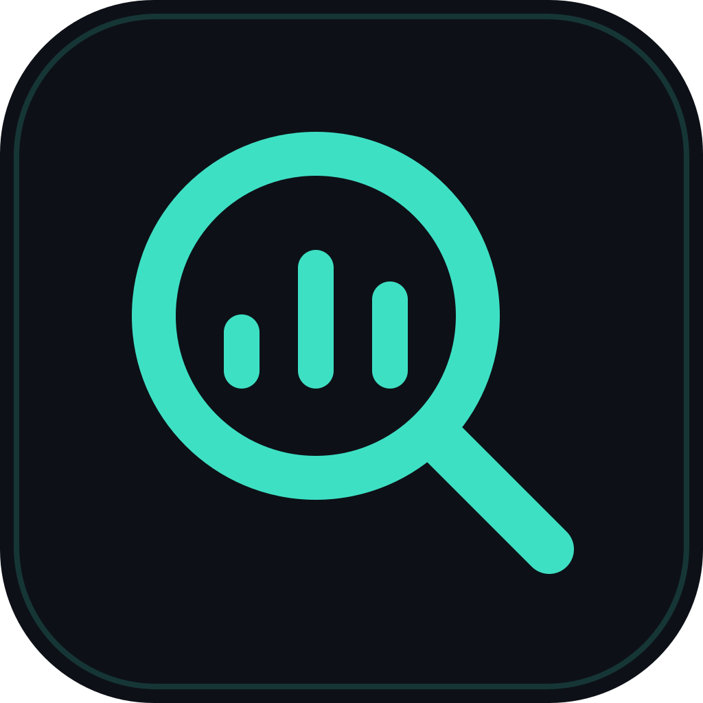
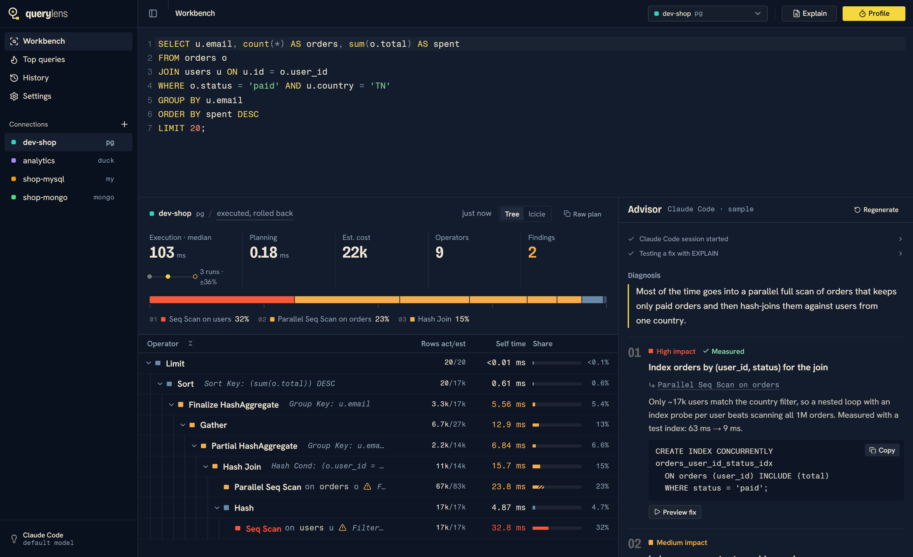

<div align="center">



# QueryLens

**Find the N+1 queries, missing indexes and other database problems in what your app actually sends.**

QueryLens sits between your application and PostgreSQL, records every statement your ORM
generates while you use the app or run its tests, and tells you what to fix, in your ORM's
own terms, with the file and line that issued it. Run it locally, gate pull requests with it
in CI, or give it to your coding agent. Everything stays on your machine.

[](https://github.com/EagleMind/querylens/actions/workflows/ci.yml)
[](LICENSE)




<sub>The workbench on the demo database. The advisor panel shows sample output.</sub>

</div>

## Quick start

In your Node.js project:

```bash
npx querylens-cli init
```

That installs the [`querylens-node`](integrations/node) SDK and adds one line at the top of your
app, like Sentry's setup. Then run your app as usual and start recording, from the desktop app
(**Capture → Start capture**) or a terminal:

```bash
npx querylens-cli capture
```

Use the app, press Ctrl+C, and get the findings, each with the line of code that caused it and the
fix for your ORM. The full report goes to `.querylens/report.md`.

Want a one-off check without touching your code? This runs your tests with the SDK preloaded:

```bash
npx querylens-cli capture -- npm test
```

QueryLens finds the database by itself (`DATABASE_URL`, `.env` files, or Sequelize's
`config/config.json`). The SDK sends nothing unless QueryLens is recording, only to
`127.0.0.1`, and is off when `NODE_ENV=production`.

<details>
<summary>Other ways to install</summary>

| | |
|---|---|
| npm (global) | `npm i -g querylens-cli`, then `querylens capture -- npm test` |
| macOS, Linux | `curl -fsSL https://raw.githubusercontent.com/EagleMind/querylens/main/install.sh \| sh` |
| Windows | `irm https://raw.githubusercontent.com/EagleMind/querylens/main/install.ps1 \| iex` |
| From source | `cargo install --git https://github.com/EagleMind/querylens --no-default-features querylens` |
| Desktop app | Installers on the [releases page](https://github.com/EagleMind/querylens/releases) |

</details>

Works with PostgreSQL. Node.js apps on `pg` (Sequelize, Knex, TypeORM, Drizzle…) are recorded
by the SDK, from inside the app, whatever their connection settings. Other stacks are recorded
by a local proxy QueryLens points them at through `DATABASE_URL` (or `--set KEY={port}` for
separate settings).

## What you get

Output from the [Sequelize demo](dev/sequelize-demo):

```
68 statements · 1.32 s of database time · 13 distinct · 5 requests · ORM: Sequelize
  HIGH   N+1: SELECT on order_items, once per row (up to 10× in a row)  (app.js:13)
  HIGH   SELECT on order_items: full table scan, an index would help  (app.js:13)
  HIGH   SELECT on orders: full table scan, an index would help  (app.js:10)
  MEDIUM INSERT into events one row at a time (up to 20× in a row)  (app.js:53)
  MEDIUM Large result from SELECT on products  (app.js:33)
  ...
```

Each finding comes with the fix for your ORM. For the N+1 above:

```js
const orders = await Order.findAll({
  where: …,
  include: [{ model: OrderItem, separate: true }],
});
```

…and, because QueryLens re-plans the statement with the values it actually ran with and tests
a hypothetical index (HypoPG), the migration to go with it:

```js
up: (queryInterface) => queryInterface.addIndex('order_items', ['order_id']),
```

### What it finds

| Finding | How |
|---|---|
| **N+1 queries** | The same SELECT run once per row of the previous result, with different values. Reports the parent query and how many rows it returned. |
| **Duplicate queries** | The identical statement repeated back to back. |
| **Writes in a loop** | INSERT / UPDATE / DELETE one row at a time (→ `bulkCreate`, one `UPDATE … WHERE id IN`). |
| **Missing indexes** | Captured statements re-planned with their real values; a scan of a large table to keep a few rows gets a candidate index, tested with HypoPG (or built and rolled back). |
| **Large results** | Thousands of rows with no LIMIT, or megabytes per call. |
| **Slow and failing statements** | Including errors the ORM swallowed. |
| **Chatty requests** | A request that runs dozens of statements. |

### ORM support

| ORM | Recognized | Fixes |
|---|---|---|
| **Sequelize** | ✓ | Code in Sequelize's API (`include`, `separate`, `bulkCreate`, `findAndCountAll`, migrations) |
| Prisma, TypeORM, Django, Active Record, SQLAlchemy, Hibernate | ✓ | The right API by name (`include`, `select_related`, `includes`, `selectinload`, `JOIN FETCH`…) |
| Anything else (or raw SQL) | – | Generic advice |

Adding an ORM is one module implementing `OrmAdvisor` (see
[src-tauri/src/capture/orm](src-tauri/src/capture/orm)).

### Where each query came from

In Node.js, the [SDK](integrations/node) records each query with the first line of your code in
the call stack and the HTTP request it served. Through the proxy, findings name the code when
the SQL carries [sqlcommenter](https://google.github.io/sqlcommenter/) tags (Rails, Django,
Spring and others can add them).

### In CI

Fail a pull request that introduces a new problem. Add one step after your database is up:

```yaml
- uses: EagleMind/querylens@main
  with:
    command: npm test
```

To accept today's findings so only new ones fail, run this once and commit
`.querylens/baseline.json`:

```bash
npx querylens-cli check --update-baseline -- npm test
```

Without GitHub Actions: `npx querylens-cli check -- npm test` exits with 1 on a new problem.

Timing-based findings never fail the gate (CI machines are noisy); N+1s, loops, missing
indexes and unbounded results do. The report goes to the job summary on GitHub Actions. The
CLI builds without the desktop app's WebView libraries (`cargo build --no-default-features`).

### For coding agents

```bash
claude mcp add querylens -- npx -y querylens-cli mcp
```

The agent gets `capture_start` / `capture_stop` (findings with fixes), `capture_statement`,
`compare_captures` (did the fix remove the N+1?), plus `explain_query` and `test_index` to
measure a single query. Everything they run is read-only and rolled back.

### In the app

The **Capture** page is the dashboard: start a capture on a saved connection, run your app
(with the SDK, it reports by itself; without, point it at the proxy URL shown), watch
statements arrive, stop to get the report. **Open in Workbench** takes any captured statement,
with its real values, to the plan view below.

## The Workbench

`EXPLAIN ANALYZE` output is precise but hard to read, and every engine prints it
differently. QueryLens connects to your database, runs the plan for you inside a safety
envelope, and turns it into one readable model across engines.

- **Time per operator, not cumulative cost.** Each operator is colored by its own
  (exclusive) time, so the slow step is obvious. One bar shows where every millisecond went.
- **Trustworthy numbers.** Profile runs the query three times and shows the median, with
  the first run's disk reads reported separately.
- **Problems flagged instantly, without AI.** Missing indexes, row misestimates, sorts and
  hashes spilling to disk, repeated lookups, in-memory sorts an index could avoid.
- **An advisor that tests before it recommends.** With Claude Code, the advisor calls
  QueryLens's own MCP tools to try an index or a rewrite, then labels each suggestion
  **Measured** or **Estimated**.
- **Before and after.** Preview a fix, compare any two runs operator by operator, and see
  when a plan changed or got slower since the last run.
- **Workload view.** Top queries lists the statements costing the most time on the server
  (`pg_stat_statements`, MySQL `performance_schema`).

## Safe by construction

| Engine | What Profile does | Limits |
|---|---|---|
| PostgreSQL | `EXPLAIN ANALYZE` in a transaction that is always rolled back; one statement only | statement and lock timeouts |
| MySQL | `EXPLAIN ANALYZE` in a **read-only** transaction: the server refuses any write | `max_execution_time`, `KILL QUERY` backstop |
| MongoDB | `explain` with `executionStats`: writes are never applied, `$out`/`$merge` refused | `maxTimeMS` |
| DuckDB | `EXPLAIN ANALYZE` on a file opened **read-only** | interrupt watchdog |

Queries issued by the AI run read-only. Explain mode never executes the query.

The capture proxy forwards your application's traffic byte for byte: it never alters, delays
or blocks a statement. If it meets protocol data it doesn't understand, it keeps relaying and
stops recording that connection. Re-planning captured statements uses the same rolled-back,
read-only envelope as Profile.

## Engines

| Engine | Capture | Profile | Explain | Schema context | Top queries | Index testing |
|---|:-:|:-:|:-:|:-:|:-:|:-:|
| PostgreSQL | ✓ | ✓ | ✓ | ✓ incl. `pg_stats` | ✓ | ✓ HypoPG or rolled-back build |
| MySQL 8.0.18+ | planned | ✓ reads | ✓ | ✓ | ✓ | – (DDL commits) |
| MongoDB | – | ✓ | ✓ | ✓ sampled fields | – | – |
| DuckDB | – | ✓ | ✓ | ✓ | – | – |

MongoDB queries are written as in the shell, for example
`db.orders.find({ status: "paid" }).sort({ total: -1 }).limit(20)` or `db.orders.aggregate([…])`.

## AI providers

| Provider | Notes |
|---|---|
| **Claude Code** (default) | Uses your existing `claude` login. Gets QueryLens as an MCP server, so it can measure fixes. |
| LM Studio, Ollama | Fully local: nothing leaves your machine. |
| OpenRouter, OpenAI, any OpenAI-compatible API | API key stored in the OS keychain. |

The model sees a compact, normalized plan plus schema facts (existing indexes, sizes,
column statistics), never table rows.

## Private

No accounts and no telemetry. Connection passwords and API keys live in the OS keychain,
and history stays in a local SQLite file.

## Building from source

Prerequisites: Node 22+, pnpm, stable Rust, and the
[Tauri prerequisites](https://v2.tauri.app/start/prerequisites/) for your OS.

```bash
pnpm install
```

```bash
pnpm tauri dev
```

### Demo databases

PostgreSQL, MySQL and MongoDB, seeded with deliberately slow queries:

```bash
docker compose -f dev/docker-compose.yml up -d --build
```

All on host `localhost`, database `shop`:

| Engine | Port | User | Password |
|---|---|---|---|
| PostgreSQL | `54329` | `querylens` | none |
| MySQL | `33069` | `querylens` | `querylens` |
| MongoDB | `27019` | none | none |

[`dev/sequelize-demo`](dev/sequelize-demo) is an Express + Sequelize app over the PostgreSQL
demo database with the usual ORM mistakes, to try capture on.

For a harder workload, `dev/load-job.sh` loads the IMDB dataset and the
[Join Order Benchmark](https://github.com/gregrahn/join-order-benchmark) queries into
PostgreSQL.

## Development

| Command | What it does |
|---|---|
| `pnpm dev` | UI only, in a browser, against a mock backend with a real captured plan |
| `pnpm tauri dev` | Full desktop app with hot reload |
| `pnpm typecheck` / `pnpm lint` / `pnpm format` | TypeScript, oxlint, Prettier |
| `pnpm bindings` | Regenerate `src/bindings/*.ts` from the Rust types (ts-rs) |
| `cd src-tauri && cargo test --lib` | Unit tests: parsers, scoring, warnings, storage, query parsing |
| `pnpm tauri build` | Release installers (`.msi`/`.exe`, `.dmg`, `.AppImage`/`.deb`) |
| `cd src-tauri && cargo build --release --no-default-features` | The headless CLI only (capture, check, report, mcp), without WebView libraries |

Live tests against the demo databases (and optionally Claude Code) are opt-in through
environment variables; see [docs/architecture.md §10](docs/architecture.md#10-build-test-ship).

```
src/            React 19 + shadcn/ui frontend
src/bindings/   TypeScript types generated from Rust (do not edit)
src-tauri/      Rust core: engines, plan parsing and scoring, capture, LLM providers, MCP server, CLI, storage
integrations/   The Node.js query-tagging hook (embedded in the binary)
dev/            Docker Compose demo databases, seed data, and the Sequelize demo app
docs/           Product, architecture and scope documents
```

## Documentation

- [Vision](docs/vision.md): the product, positioning, and what it is not
- [Architecture](docs/architecture.md): stack, data model, safety envelope, capture pipeline, LLM and MCP design
- [Scope](docs/mvp.md): what shipped, what's deferred

## License

[MIT](LICENSE)
