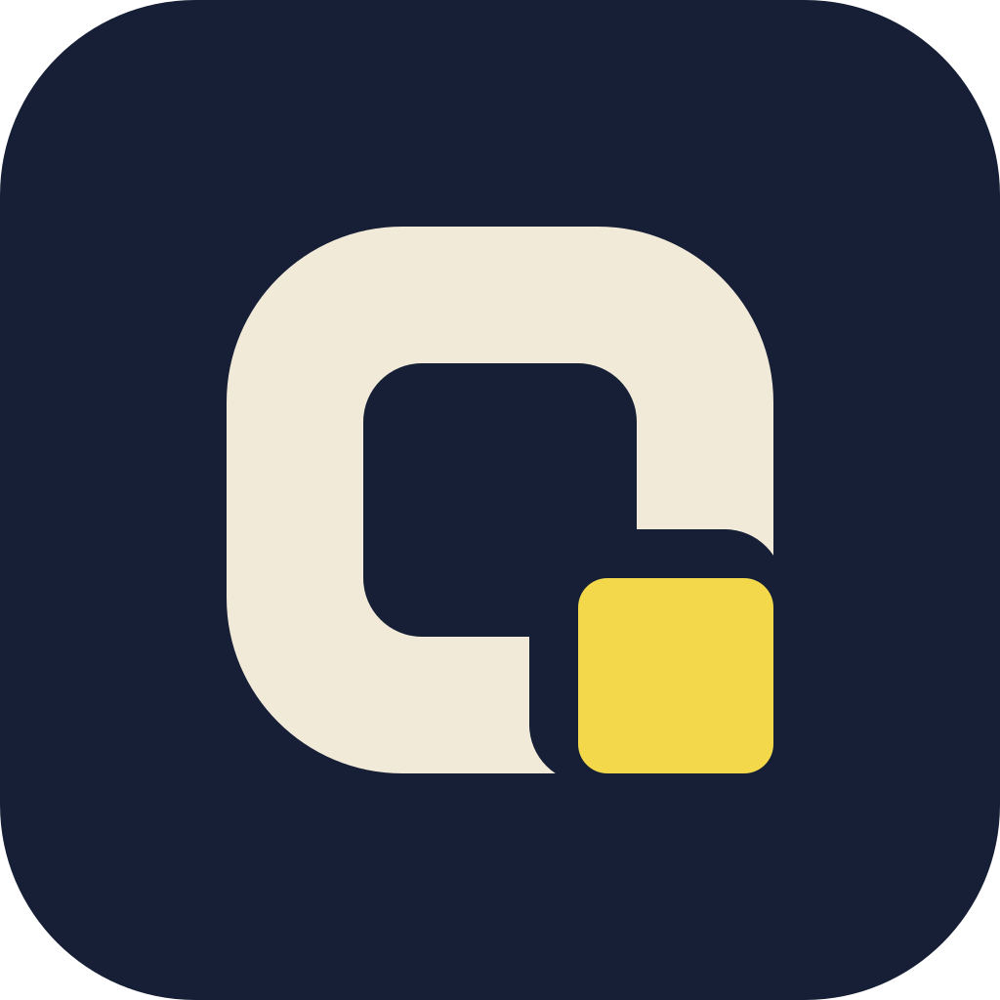

<div align="center">



# QueryLens

**Monitor the SQL your app sends in production. Catch N+1 queries, writes in a loop and
slow statements, and get the fix for your ORM, down to the line of code.**

[](https://github.com/EagleMind/querylens/actions/workflows/ci.yml)
[](https://www.npmjs.com/package/querylens-node)
[](integrations/node)
[](LICENSE)
<br>
[](cloud)


[](crates/core)

</div>

QueryLens is an error tracker for your database traffic. A small SDK in your Node.js backend
watches every query your ORM sends to PostgreSQL or MySQL, removes the values, and reports
the requests that look wrong to a backend you deploy in your own Cloudflare account, on the
free plan. The web dashboard shows requests live, groups the problems it finds into issues
across requests and releases, and gives each one the code location responsible and the fix
written for your ORM.

```
your app + querylens-node ──── values removed, gzipped ────▶ your Cloudflare Worker ──▶ dashboard
  (pg / postgres.js / mysql2)                                 Rust analysis (WebAssembly)
                                                               issues, stats, live feed (Durable Objects)
```

## What it finds

| Finding | What it looks like | Typical fix |
|---|---|---|
| **N+1 queries** | The same SELECT run once per row of the previous result, with different values | Eager loading (`include`, `relations`, `JOIN`) |
| **Duplicate queries** | The identical statement repeated back to back | Run it once and reuse the result |
| **Writes in a loop** | INSERT / UPDATE / DELETE one row at a time | `bulkCreate`, one `UPDATE … WHERE id IN (…)` |
| **Large results** | Thousands of rows with no LIMIT | Pagination, selecting only the columns used |
| **Slow statements** | Over 100 ms (adjustable) | An index, with the migration to add it |
| **Failing statements** | Errors, including ones the ORM swallowed | The error, its statement and its caller |
| **Chatty requests** | One request running 50+ statements (adjustable) | Batching, eager loading |

Every issue links to the line of your code that ran the statement, the route, the
environment and release, and the latest requests where it happened. A resolved issue that
comes back is flagged as **regressed**.

## Requirements

**In your app**

- Node.js 18 or later
- PostgreSQL through [`pg`](https://node-postgres.com/) or [`postgres`](https://github.com/porsager/postgres)
  (postgres.js), or MySQL through [`mysql2`](https://sidorares.github.io/node-mysql2/), used
  directly or by your ORM

**For the backend**

- A Cloudflare account. The [Workers Free plan](cloud/README.md#free-plan-budget) is enough.
- Node.js and [pnpm](https://pnpm.io/) to deploy it. Rust is only needed if you change the
  analysis, since the WebAssembly build is committed.

## Get started

### 1. Deploy the backend

```bash
cd cloud
```

```bash
pnpm install
```

```bash
pnpm exec cf auth login
```

```bash
pnpm run deploy
```

Then set the dashboard's sign-in token, a long random string you choose:

```bash
npx wrangler secret put ADMIN_TOKEN --name querylens
```

The dashboard is now at `https://querylens.<your-subdomain>.workers.dev`. See
[cloud/README.md](cloud/README.md) for running it locally and for the free-plan budget.

### 2. Create a project

Sign in with your token, create a project for your app, and copy its DSN from **Settings**.

### 3. Add the SDK to your app

```bash
npm install querylens-node
```

Give your app the DSN:

```bash
QUERYLENS_DSN=https://<key>@querylens.<your-subdomain>.workers.dev/<project>
```

Load the SDK before anything else, as the first line of your entry file:

```js
require('querylens-node/register')
// or, in ESM / TypeScript:
import 'querylens-node/register'
```

On Next.js, put it in `instrumentation.ts`:

```ts
export async function register() {
  if (process.env.NEXT_RUNTIME === 'nodejs') await import('querylens-node/register')
}
```

For background jobs and serverless functions, name the work and flush before returning:

```js
const { withTransaction, flush } = require('querylens-node')

await withTransaction('job:send-invoices', () => sendInvoices())
await flush()
```

### 4. Watch it work

Use your app, then open the dashboard: every statement of the requests the SDK sends appears
on **Live** as it arrives. Click one for its report: the SQL, the line of your code that ran
it, the issue it belongs to with the fix, the rest of its request and its last 24 hours.

No app handy? [`dev/sequelize-demo`](dev/sequelize-demo) is an Express + Sequelize app with
the usual ORM mistakes built in, against a demo PostgreSQL or MySQL in Docker.

### Configuration

| Variable | Effect |
|---|---|
| `QUERYLENS_DSN` | Where to report. Without it the SDK does nothing. |
| `QUERYLENS_ENVIRONMENT` | Environment name. Default: `NODE_ENV`, else `production`. |
| `QUERYLENS_RELEASE` | Release. Default: the commit from Vercel, Render, Railway, Heroku, Cloudflare Pages, GitHub Actions and others. |
| `QUERYLENS_SAMPLE_RATE` | Share of problem-free requests sent to the live feed. |
| `QUERYLENS_SEND_VALUES=1` | Send SQL literals and parameters too, for example in development. |
| `QUERYLENS_DISABLED=1` | Turn the SDK off. |

Detection thresholds (slow, large, loop and chatty limits) and live-feed sampling are set
per project through the API (`PUT /api/0/projects/<id>/settings`) and reach running apps on
their next report. The
[SDK's README](integrations/node) covers the options and exactly what is sent.

## Private by default

- **No values leave your app in production.** Literals become `?`, bound parameters are
  dropped, and quoted values are removed from error messages. A hash of the values is all
  that's kept, which is how an N+1 (different values) is told apart from a repeated query.
- **Your queries are never changed, and nothing waits on QueryLens.** Reports go out in the
  background, batched and gzipped. If anything fails inside the SDK, your query runs as if
  it weren't there. (The one exception is Prisma's opt-in [engine mode](integrations/node#prisma).)
- **Bounded memory.** When the backend is unreachable the SDK backs off and drops the oldest
  data, never holding more than about 4 MB.
- **Your data stays in your Cloudflare account.** There is no QueryLens service in between.
- **No dependencies** in the SDK.

## What's supported

| | Supported today |
|---|---|
| **Runtime** | Node.js 18+ (CommonJS and ESM, Next.js) |
| **Databases** | PostgreSQL, MySQL |
| **Drivers** | `pg`, `postgres` (postgres.js), `mysql2` (connections, pools and the promise API) |
| **Captured through** | Sequelize, Knex, TypeORM, MikroORM, Drizzle (`node-postgres`, `postgres-js`, `mysql2`), the drivers directly, and Prisma with the [`querylens-node/prisma`](integrations/node#prisma) extension (through `@prisma/adapter-pg`, or Prisma 6's Rust engine with `engine: true`) |
| **Fixes with code** | Sequelize (`include` with `separate`, `bulkCreate`, `findAndCountAll`…) |
| **Fixes naming the right API** | Prisma, TypeORM, plus Django, Active Record, SQLAlchemy and Hibernate, which the analysis already recognizes |
| **Backend** | Cloudflare Workers + Durable Objects (SQLite), free plan |
| **Dashboard** | Live queries with built-in and custom filters, and a report per query down to the line of code |

## Roadmap

**Next**

- **AI-suggested optimizations.** A rewrite for each issue, from the scrubbed statement, the
  finding and your ORM, with Workers AI or Claude.
- **Alerts** on new and regressed issues, by email or webhook.
- **Sign-in with Cloudflare Access** instead of a shared token.
- **Code-level fixes for more ORMs**, starting with the ones that only get API names today.

**Later**

- **SDKs beyond Node.js**, so the Python, Ruby and Java ORMs the analysis already recognizes
  get monitored too.

## Repository

```
integrations/node/   the SDK (querylens-node on npm)
cloud/               the backend (Worker + Durable Objects) and the dashboard (React)
crates/core/         the analysis: fingerprints, pattern detection, ORM fixes (Rust)
crates/wasm/         crates/core compiled to WebAssembly for the backend
dev/                 demo PostgreSQL and MySQL, and a Sequelize app with the usual ORM mistakes
docs/                architecture
```

## Development

| Command | What it does |
|---|---|
| `cargo test --workspace` | Rust tests (also regenerates `cloud/bindings` from the Rust types) |
| `node --test "integrations/node/*.test.cjs"` | SDK tests |
| `cd cloud && pnpm dev` | Backend and dashboard locally, at http://localhost:5173 |
| `cd cloud && pnpm build:core` | Rebuild the WebAssembly module after changing `crates/` |
| `cd cloud && pnpm typecheck` | TypeScript (Worker and dashboard) |
| `docker compose -f dev/docker-compose.yml up -d` | The demo databases for `dev/sequelize-demo` |

See [docs/architecture.md](docs/architecture.md) for how the pieces fit together.

## License

[MIT](LICENSE)
